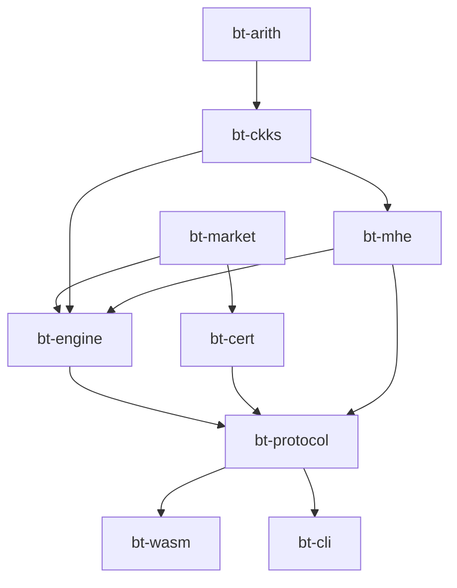

# 01. Repositories, architecture and containers

## 1. Repositories

Use two repositories, plus an optional third later.

| Repository | Visibility | Licence | Contents |
|---|---|---|---|
| `certified-blind-transport` | Public | Apache-2.0 OR MIT (dual, the Rust norm) | The Rust workspace, the demo web app, docs (this folder), spikes, containers, CI. This is the artefact people inspect and rebuild. |
| `lance-tersou-site` | Public (or private if you prefer) | Your choice | The personal website. It **consumes** a released build of the demo (pinned version and SHA-256) and embeds it in the Blind transport section. |
| `bt-gpu-server` (optional, M9) | Public | Apache-2.0 OR MIT | A native server party: the same `bt-engine` crate behind a WebSocket, optionally with your CUDA NTT backend. |

Why split the site from the demo? The demo is a research artefact with its own releases, tests and reviewers. The site is personal content. Pinning the demo by version and hash means a site deploy can never silently change the cryptography, and visitors can check that the hash on the page matches the GitHub release.

## 2. Monorepo layout: `certified-blind-transport`

```
certified-blind-transport/
├── Cargo.toml                 # [workspace], shared [workspace.dependencies], profiles
├── Cargo.lock                 # committed (needed for reproducible builds)
├── rust-toolchain.toml        # pinned toolchain + wasm32 target
├── .cargo/config.toml         # wasm rustflags (simd128, getrandom backend)
├── justfile                   # all build/test commands (see docs/02)
├── crates/
│   ├── bt-arith/              # modular arithmetic, primes, NTT, RNS bases
│   ├── bt-ckks/               # RNS-CKKS: encoder, keys, evaluator, key switching
│   ├── bt-mhe/                # two-party threshold layer: CRS, CKG, RKG, RTG, decrypt shares, refresh
│   ├── bt-market/             # market model, closed-form 1-D OT, plaintext Sinkhorn, clearing price, rounding
│   ├── bt-engine/             # encrypted matching engine (v1 closed form; v2 Sinkhorn behind a feature flag)
│   ├── bt-cert/               # Pedersen, Bulletproofs, gap commitment, certificate verification
│   ├── bt-protocol/           # message types, party state machines, transcripts, cheat hooks
│   ├── bt-wasm/               # wasm-bindgen exports, one handle per role
│   └── bt-cli/                # native end-to-end harness, benchmarks, test-vector generation
├── web/
│   └── demo/                  # Vite + TypeScript app (docs/10)
│       ├── src/
│       │   ├── main.ts        # UI bootstrap, mounts into #cbt-demo
│       │   ├── bus.ts         # message router + logger (the "network")
│       │   ├── verifier.ts    # verifier logic (calls bt-wasm verify functions)
│       │   ├── workers/
│       │   │   ├── firm.worker.ts
│       │   │   └── server.worker.ts
│       │   ├── ui/            # panels: ladder, server, network log, certificate, checks
│       │   └── styles/        # design tokens shared with the site
│       ├── public/fonts/      # self-hosted Martian Mono + Hanken Grotesk
│       ├── index.html         # standalone page for development and /demo/
│       └── vite.config.ts
├── docs/                      # this plan; later the threat model and spec
├── spikes/                    # Python experiments (reproduce docs/04)
├── test-vectors/              # JSON vectors produced by bt-cli, checked by wasm tests
├── docker/
│   ├── build.Dockerfile       # pinned toolchain image (reproducible builds)
│   ├── Caddyfile              # local preview server with production headers
│   └── compose.yml            # preview + e2e services
├── .devcontainer/devcontainer.json
└── .github/workflows/
    ├── ci.yml
    └── release.yml
```

## 3. Crates and dependencies



| Crate | Responsibility | Key external crates (pin versions at M0; check each compiles for `wasm32-unknown-unknown`) |
|---|---|---|
| `bt-arith` | `u64` modular arithmetic (Barrett, Shoup), NTT-friendly prime search (deterministic Miller–Rabin), primitive 2N-th roots, negacyclic NTT (Cooley–Tukey forward, Gentleman–Sande inverse, Harvey lazy butterflies), RNS bases and fast basis conversion | none (pure Rust); `proptest` for tests |
| `bt-ckks` | Parameters, encoder (special FFT), sampling, secret/public/relinearisation/rotation keys, ciphertext and plaintext types, evaluator, hybrid key switching, serialisation | `rand_core`, `rand_chacha`, `serde`, `postcard`, `num-complex` (optional; the FFT can be written by hand) |
| `bt-mhe` | Two-party threshold protocols over `bt-ckks`: CRS from a seed, collective public key, two-round relinearisation key, rotation keys, decryption shares with smudging noise, collective refresh | `rand_chacha`, `sha2` |
| `bt-market` | Market definition, integer price units, closed-form 1-D OT, plaintext log-domain Sinkhorn (for v2 and explanations), rounding, clearing-price search, gap computation in integers | none; `proptest` |
| `bt-engine` | Encrypted matching: data layout, public linear maps, polynomial sign/abs/min/max, refresh scheduling, output masking | `bt-ckks`, `bt-mhe`, `bt-market` |
| `bt-cert` | Pedersen commitments, Bulletproofs range proofs, homomorphic residual and gap commitments, per-firm settle proofs, verification | `curve25519-dalek`, `bulletproofs`, `merlin`, `sha2`, `subtle` |
| `bt-protocol` | Message enums, session parameters, party state machines (`FirmAgent`, `Server`, `Verifier`), transcript hashing, `demo-cheats` feature | `serde`, `postcard`, `sha2` |
| `bt-wasm` | `wasm-bindgen` façade: `FirmHandle`, `ServerHandle`, `VerifierHandle`, `info()` | `wasm-bindgen`, `js-sys`, `serde-wasm-bindgen`, `console_error_panic_hook`, `getrandom` (wasm backend) |
| `bt-cli` | Runs the full protocol natively, writes `test-vectors/`, benchmarks | `clap`, `criterion`, `serde_json` |

**Version caution.** Do not copy version numbers from memory, including mine. At M0, add each dependency with `cargo add`, then confirm `cargo build --target wasm32-unknown-unknown` succeeds. The two known risk points are:
- `bulletproofs`, which pins its own `curve25519-dalek` major version: use the curve types it re-exports so they match;
- `getrandom`, which needs its WebAssembly backend enabled (the method differs between 0.2 and 0.3; see `docs/02`).

## 4. Runtime architecture (in the browser)

### 4.1 Threads and what each holds

| Thread | Code | Holds | Never holds |
|---|---|---|---|
| Main thread | UI, `bus.ts` (router and logger), `verifier.ts` | Public parameters, public keys, commitments, proofs, public record. For the "All data" view, the UI also holds the orders the visitor typed (you are the god's-eye view, and the UI says so) | Any secret-key share |
| Worker "Firm A" | `firm.worker.ts` + `bt-wasm` `FirmHandle` | Firm A's order book, its key share `s_A`, its commitment openings (blinding factors), smudging randomness | `s_B`, Firm B's openings |
| Worker "Firm B" | same, with role B | Firm B's book, `s_B`, its openings | `s_A`, Firm A's openings |
| Worker "Server" | `server.worker.ts` + `ServerHandle` | Public key, relinearisation key (plus rotation keys in v2), ciphertexts | Any secret-key share or plaintext order |

The separation is real: each worker instantiates its own WebAssembly module with its own linear memory, and the only channel between them is `postMessage` through the main-thread router. Visitors can confirm this in developer tools (Sources → Threads, and the network log panel).

### 4.2 Message routing

All messages are `postcard`-encoded bytes in an `ArrayBuffer`, transferred (not copied) to the router. The router:
1. records `{seq, from, to, type, bytes, sha256}` for the network-log panel;
2. applies demo cheat hooks only when a cheat scenario is active (for example tampering with bytes in transit, to show the certificate catching it);
3. forwards to the destination worker.

### 4.3 Why Web Workers

- **Real isolation of secrets** between the firms and the server, which is the property the demo is about.
- **Responsiveness:** CKKS work runs off the main thread, so the UI animates while the server computes.
- **Parallelism:** the two firms compute their shares at the same time.

Version 1 does **not** use WebAssembly threads (SharedArrayBuffer), so the site does not need the cross-origin isolation headers (COOP/COEP). Rayon-style parallelism inside a worker can come later.

### 4.4 Memory budget (toy parameters N = 2¹², 12 scaling primes + q₀ + 3 special primes, dnum = 5)

- A ciphertext at the top level has 2 × 13 RNS limbs × 4096 coefficients × 8 bytes ≈ **0.85 MB**.
- A key-switching key has dnum (5) × 2 × 16 limbs × 4096 × 8 bytes ≈ **5.2 MB**.
- The **v1** engine needs only the relinearisation key (≈ 5 MB), because the firms pre-compute their own cumulative sums and no rotations are needed (`docs/07` §1). The **v2** Sinkhorn engine adds about 12 rotation keys (≈ 60 MB more), held by the server worker only.
- The firms send key shares of the same sizes once during setup. That is the largest transfer, so show it in the network log. To halve it, send only the non-CRS half of each share (the CRS half is derived from the shared seed).

All of this fits comfortably in a desktop browser. On phones, cap concurrency and show a warning that setup takes longer.

## 5. Containers

There is **no backend container in v1**: everything runs client-side. Containers serve reproducibility, developer experience and testing.

### 5.1 `docker/build.Dockerfile`: the reproducible build image

Purpose: anyone can rebuild the exact `.wasm` and get the same SHA-256.

- Base: an official Rust image pinned **by digest**, not by tag.
- Adds: the `wasm32-unknown-unknown` target; `wasm-bindgen-cli` at **exactly** the version of the `wasm-bindgen` crate in `Cargo.lock`; `binaryen` (`wasm-opt`) at a pinned release; Node.js LTS for the web build; `just`.
- Sets `SOURCE_DATE_EPOCH` and `--remap-path-prefix` so paths and timestamps do not leak into the binary.

The full Dockerfile is in `docs/02`.

### 5.2 `.devcontainer/devcontainer.json`

Points VS Code or Codespaces at the same build image, so local development equals CI.

### 5.3 `docker/compose.yml`: local preview and end-to-end tests

- `preview`: Caddy serving `web/demo/dist` with production headers (correct `application/wasm` MIME type, Content Security Policy). Use it to test exactly what visitors will get.
- `e2e`: the official Playwright image running the end-to-end suite against `preview`.

### 5.4 Optional (M9): `bt-gpu-server`

A native Rust binary (`axum` + WebSocket) that plays the server role with the same `bt-engine` code, optionally with a CUDA NTT backend from your GPU work. It ships as a container with the NVIDIA runtime. In the demo, a toggle "Run the server on a real remote GPU" swaps the server worker for a WebSocket connection. It is the strongest possible tie between the demo and your day job, but it is not needed for v1.

## 6. Hosting and headers

The demo is static files: `index.html`, JavaScript bundles, two `.wasm` files (or one shared), fonts.

Required headers (Cloudflare Pages `_headers`, Netlify `_headers`, or Vercel `vercel.json`):

```
/*
  Content-Security-Policy: default-src 'self'; script-src 'self' 'wasm-unsafe-eval'; worker-src 'self' blob:; style-src 'self'; font-src 'self'; img-src 'self' data:; connect-src 'self'; frame-ancestors 'self'
  X-Content-Type-Options: nosniff
  Referrer-Policy: no-referrer
  Permissions-Policy: interest-cohort=()
/*.wasm
  Content-Type: application/wasm
  Cache-Control: public, max-age=31536000, immutable
```

Notes:
- `'wasm-unsafe-eval'` is the narrow CSP keyword browsers require to compile WebAssembly. It does not allow JavaScript `eval`.
- Self-host the fonts, so the cypherpunk audience sees no request to Google.
- Add `Cross-Origin-Opener-Policy: same-origin` and `Cross-Origin-Embedder-Policy: require-corp` only if WebAssembly threads are adopted later.

## 7. Embedding the demo into the website

Preferred: **module mount**. The site's Blind transport section contains `<div id="cbt-demo"></div>` and loads the released demo bundle from `/demo/` on the same origin (copied in at site build time, version pinned in the site repo's `demo.lock` with its SHA-256). The demo reads the site's CSS tokens, so it inherits the cypherpunk palette.

Fallback: a standalone page at `/demo/` linked from the section, for small screens or if embedding causes layout issues.
