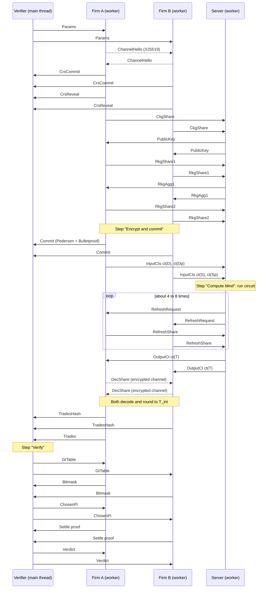

# 09. Protocol, messages and Web Worker wiring (`bt-protocol`, `bt-wasm`, `web/demo/src`)

## 1. Session parameters (public, fixed before anything else)

```rust
pub struct SessionParams {
    pub session_id: [u8; 32],          // random, chosen by the verifier (the UI)
    pub grid: Grid,                    // levels = 8, top_ticks = 1004
    pub limit: u64,                    // 50_000 micro-lots
    pub ckks: ParamsId,                // hash of the CKKS Params (TOY-12 by default)
    pub engine: EngineId,              // ClosedForm1D (v1)
    pub sign: SignSpec,                // polynomial family + iteration counts (the UI "precision" setting)
    pub kappa: u64,                    // rounding margin, 2 micro-lots
    pub rho_ppm: u64,                  // tolerance ρ in parts per million (5_000 = 0.5%)
    pub smudge_lambda: u32,            // statistical bits for decryption smudging (toy: 11)
    pub mask_lambda: u32,              // statistical bits for refresh masks (40)
    pub demo_mode: bool,               // enables the oracle for the simulated check and the cheat hooks
}
```

The hash of `SessionParams` goes into every transcript and every message header.

## 2. Message catalogue

Every message is `postcard`-encoded with the header `{version, session_id, seq, from, to, kind}`. "Size" is the approximate size at `TOY-12`.

| # | Kind | From → to | Content | Size |
|---|---|---|---|---|
| 0 | `Params` | V → all | `SessionParams` | < 1 KB |
| 1 | `ChannelHello` | A ↔ B | X25519 ephemeral public key (firm-to-firm channel, §5) | 32 B |
| 2 | `CrsCommit` | A, B → all | H(σ_i) | 32 B |
| 3 | `CrsReveal` | A, B → all | σ_i | 32 B |
| 4 | `CkgShare` | A, B → S | p_i (non-CRS half only) | ≈ 0.4 MB |
| 5 | `PublicKey` | S → all | pk (b part; the a part comes from the CRS) | ≈ 0.4 MB |
| 6 | `RkgShare1` | A, B → S | h0_{i,g}, h1_{i,g} for each digit g | ≈ 5 MB |
| 7 | `RkgAgg1` | S → A, B | h0_g, h1_g | ≈ 5 MB |
| 8 | `RkgShare2` | A, B → S | h0'_{i,g}, h1'_{i,g} | ≈ 5 MB |
| 9 | `Commit` | A, B → V | `CommitPhase` (8 commitments + Bulletproof) | ≈ 1.3 KB |
| 10 | `InputCts` | A → S; B → S | ct(D), ct(Dp) or ct(S), ct(Sp) | ≈ 1.7 MB |
| 10b | `OracleDisclosure` (demo mode only) | A, B → V | plaintext of what was encrypted + commitment openings | < 1 KB |
| 11 | `RefreshRequest` | S → A, B | round r; c1 of each live register (level 1) | ≈ 64 KB × registers |
| 12 | `RefreshShare` | A, B → S | h0_i (level 1), h1_i (level L) per register | ≈ 0.5 MB × registers |
| 13 | `OutputCt` | S → A, B | ct(T) (dropped to level 1) | ≈ 64 KB |
| 14 | `DecShare` | A ↔ B, **encrypted channel** | d_i (smudged) | ≈ 64 KB |
| 15 | `TradesHash` | A, B → V | SHA-256 of T_int | 32 B |
| 16 | `Trades` | A (or B) → V | T_int (64 integers) | < 1 KB |
| 17 | `GtTable` | V → all | G_T(Π_c) for the 16 candidates | < 1 KB |
| 18 | `Bitmask` | A, B → V | m_i[c] | 2 B |
| 19 | `ChosenPi` | V → all | Π | 8 B |
| 20 | `Settle` | A, B → V | `SettleProof` | ≈ 1.5 KB |
| 21 | `Verdict` | V → all | `Verdict` + public record hash | < 2 KB |

## 3. Sequence



Key generation (messages 1–8) runs as soon as the page opens the demo, in the background, so pressing "Encrypt and commit" feels instant. The UI shows "setting up keys… 12 MB exchanged" in the network log while it runs.

## 4. Party state machines (`bt-protocol`)

```rust
pub enum FirmState {
    Init, ChannelReady, CrsCommitted, CrsAgreed, CkgSent, Rkg1Sent, Rkg2Sent, KeysReady,
    Committed, InputsSent, Serving /* answering refresh requests */, Decrypting, Decoded,
    BitmaskSent, SettleSent, Done(Verdict), Aborted(AbortReason),
}
pub enum ServerState { Init, CollectingCkg, CollectingRkg1, CollectingRkg2, KeysReady,
    AwaitingInputs, Running { pc: usize }, AwaitingRefresh { round: u32, pc: usize }, OutputSent, Aborted(AbortReason) }
pub enum VerifierState { Init, CommitsVerified, TradesFixed, PiChosen, Done(Verdict), Aborted(AbortReason) }
```

Each state machine is a pure function: `fn on_message(&mut self, msg: Msg, rng) -> Vec<Msg>` plus, for the server, `fn step(&mut self) -> Option<Progress>` (one circuit op per call; §6.2). Pure state machines make the protocol testable natively (`bt-cli` runs all parties in one process) and identical in the browser.

**Abort rules.** Any verification failure, header mismatch, unexpected message for the current state, or timeout moves a party to `Aborted(reason)`. The reason is broadcast so the UI can explain it in plain language. No decryption share is ever sent after an abort.

## 5. The firm-to-firm channel (small, real)

Decryption shares must not reach the server, and in this demo every message passes through the main-thread router. Firms therefore talk over an authenticated encrypted channel:
- **Key agreement:** X25519 ephemeral keys (`x25519-dalek`) exchanged in `ChannelHello`. The shared secret goes through HKDF-SHA256 (bound to session_id) to give a ChaCha20-Poly1305 key (`chacha20poly1305` crate).
- **Messages:** 14 (`DecShare`) is sent as AEAD ciphertext with associated data = header.
- **Demo caveat:** the hello messages are not authenticated by long-term identity keys (no PKI in a demo). The UI notes "unauthenticated key exchange: fine for a demo where you control both firms".

The network log therefore shows `DecShare` as opaque bytes, and visitors can see that the server never receives it.

## 6. Browser wiring

### 6.1 `bt-wasm` exports

```rust
#[wasm_bindgen] pub fn info() -> JsValue;                                   // crate, version, commit, wasm sha256 (injected at build), params, "toy, insecure"

#[wasm_bindgen] pub struct FirmHandle { inner: FirmAgent }
#[wasm_bindgen] impl FirmHandle {
    #[wasm_bindgen(constructor)] pub fn new(role: &str, params: &[u8]) -> FirmHandle;
    pub fn set_book(&mut self, book: &[u64]);                               // from the UI (demo: you are both firms)
    pub fn set_cheat(&mut self, cheat: &str);                               // demo_mode only
    pub fn on_message(&mut self, msg: &[u8]) -> js_sys::Array;              // returns [Uint8Array] of outgoing messages
    pub fn start(&mut self) -> js_sys::Array;                               // kick off key generation
}

#[wasm_bindgen] pub struct ServerHandle { inner: Server }
#[wasm_bindgen] impl ServerHandle {
    #[wasm_bindgen(constructor)] pub fn new(params: &[u8]) -> ServerHandle;
    pub fn set_cheat(&mut self, cheat: &str);
    pub fn on_message(&mut self, msg: &[u8]) -> js_sys::Array;
    pub fn step(&mut self) -> JsValue;                                      // {op, level, micros, keyswitches, refresh?: bool, done?: bool, out?: Uint8Array[]}
}

#[wasm_bindgen] pub struct VerifierHandle { inner: Verifier }
#[wasm_bindgen] impl VerifierHandle {
    #[wasm_bindgen(constructor)] pub fn new(params: &[u8]) -> VerifierHandle;
    pub fn on_message(&mut self, msg: &[u8]) -> js_sys::Array;
    pub fn checks(&self) -> JsValue;                                        // live CheckResult list for the UI
}

#[wasm_bindgen] pub fn decode_header(msg: &[u8]) -> JsValue;                 // for the network log (no secrets)
```

The verifier runs on the main thread. It is light: Bulletproof verification takes milliseconds.

### 6.2 Worker bootstrap (TypeScript sketch)

```ts
// workers/firm.worker.ts
import init, { FirmHandle } from "../pkg/bt_wasm.js";
let firm: FirmHandle;
self.onmessage = async (e: MessageEvent) => {
  const { type, payload } = e.data;
  if (type === "init") {
    await init();                                   // loads and instantiates bt_wasm_bg.wasm
    firm = new FirmHandle(payload.role, payload.params);
    firm.set_book(payload.book);
    if (payload.cheat) firm.set_cheat(payload.cheat);
    post(firm.start());
  } else if (type === "msg") {
    post(firm.on_message(new Uint8Array(payload)));
  }
};
function post(out: Uint8Array[]) {
  for (const m of out) self.postMessage({ type: "msg", payload: m.buffer }, [m.buffer]);   // transfer, don't copy
}

// workers/server.worker.ts: the same, plus a cooperative compute loop
async function run() {
  for (;;) {
    const p = server.step();                         // one circuit op
    self.postMessage({ type: "progress", payload: p });
    if (p.out) post(p.out);
    if (p.refresh || p.done) return;                 // wait for refresh shares, or finished
    if (performance.now() - lastYield > 16) { await new Promise(r => setTimeout(r)); lastYield = performance.now(); }
  }
}
```

### 6.3 The bus (`bus.ts`)

```ts
type Route = "A" | "B" | "S" | "V";
export class Bus {
  log: NetEntry[] = [];                               // {seq, from, to, kind, bytes, sha256, t}
  constructor(private workers: Record<"A"|"B"|"S", Worker>, private verifier: VerifierHandle) {}
  async deliver(bytes: ArrayBuffer) {
    const h = decode_header(new Uint8Array(bytes));    // from wasm: from, to, kind
    this.log.push({ ...h, bytes: bytes.byteLength, sha256: await sha256hex(bytes), t: performance.now() });
    for (const dst of h.to as Route[]) {
      if (dst === "V") this.handleVerifierOut(this.verifier.on_message(new Uint8Array(bytes)));
      else this.workers[dst].postMessage({ type: "msg", payload: bytes.slice(0) }, []);   // copy when multicasting
    }
  }
}
```

- **Multicast:** copy the buffer for each extra destination; transfer only for the last.
- **Back-pressure:** not needed. The protocol is lock-step, and the largest messages (key shares) are a few MB.
- **"Start over":** terminate all three workers and create new ones. Session state lives only in workers, so this is a clean reset.

### 6.4 Randomness

- Firm and server workers seed their RNGs from `getrandom` (the browser's `crypto.getRandomValues`).
- **Never** derive secrets from `Math.random()`. Add a lint rule banning it in `web/demo/src` (the old simulated demo used it).

## 7. Metrics the UI displays (all measured)

| Metric | Source |
|---|---|
| Bytes per message, totals per party | Bus log |
| Time per circuit op, level, key switches | `ServerHandle::step()` progress events (`performance.now()` inside wasm via `web-sys`) |
| Number of refreshes and their round-trip time | Bus log timestamps |
| Proof sizes and verification times | `VerifierHandle::checks()` |
| wasm module SHA-256 and build commit | `info()` (injected at build time) |

## 8. M6 integration tests (Playwright)

1. Honest run: the verdict is accepted, the trades shown equal `bt-market::monotone_coupling` of the entered books (computed in a test-only wasm export), and the network log contains no plaintext order values (grep the logged bytes for the encoded book values).
2. The server worker never receives message kind 14 (`DecShare`).
3. Every cheat in `docs/08` §7 produces the expected failing check and no reveal.
4. "Start over" mid-computation terminates the workers, and a new run succeeds.
5. Reduced-motion and keyboard-only runs complete.
