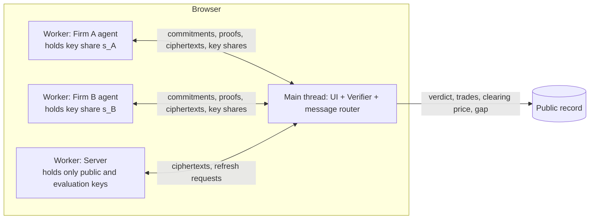

# Certified Blind Transport: engineering plan

Status: plan, version 1, 27 October 2026. Owner: Lance Tersou.

This folder is the build plan for the real version of the "Blind transport" demo on the website. It replaces the simulated demo with one where the cryptography genuinely runs in the browser, compiled from Rust to WebAssembly.

Read the documents in order. Each one is written so you can implement from it directly.

## What we are building

Two rival trading firms each run an agent holding a private order book. They want to trade with each other without revealing their books to each other or to the server that matches them. Afterwards anyone should be able to check that the matching was done correctly.

The system combines three techniques. Each covers a weakness of the others.

| Technique | Job | Where |
|---|---|---|
| **Optimal transport (OT)** | Defines the matching (the welfare-maximising transport plan between buy and sell volume) and supplies the integrity check through linear-programming duality | `docs/03`, `docs/07`, `docs/08` |
| **Fully homomorphic encryption (CKKS)** | The server computes the matching on encrypted order sizes. The firms hold a split key, so neither can decrypt alone | `docs/05`, `docs/06`, `docs/07` |
| **Zero knowledge (Pedersen commitments, Bulletproofs)** | Locks each firm's orders before anything runs and proves facts about them without revealing them | `docs/08` |

**The innovation in one sentence:** the server is never trusted. Instead of proving how it computed (impossibly expensive), the firms check that the decrypted trades are *optimal* for the committed orders, using a single public clearing price as an OT duality certificate. Approximation error, shortcuts or tampering inside the encrypted computation can therefore get a result rejected, but can never get a wrong result accepted.

## Two corrections to the earlier research report

Experiments in `docs/04-spike-findings.md` (scripts in `spikes/`) changed the design in two places.

1. **Do not decrypt Sinkhorn's scaling vectors or potentials.** The report's protocol had both firms decrypt them to build the certificate. Together with the public prices, those vectors determine the whole plan, including each firm's *unfilled* orders, so Firm A would learn Firm B's book. The fix: for a single-asset market, **one public clearing price Π is a complete optimality certificate**. Tested on 2,002 books: every optimal result certifies with gap exactly 0, and withholding even 5 lots makes the gap positive at every price. Each firm then proves its own share of the gap in zero knowledge, so no joint opening is needed (`docs/08` §4).

2. **Encrypted Sinkhorn is not accurate enough for the certificate. Version 1 uses the exact closed form of one-dimensional OT instead.** At an ε small enough for the certificate, Sinkhorn's scaling values reach about 10²¹, far beyond CKKS range. At a CKKS-friendly ε the trades lose 27–40% of the achievable welfare. Bounded reformulations diverged or collapsed in emulation. But this market is one-dimensional (a single price axis), and one-dimensional OT has an exact closed form, the *monotone coupling*. It needs only public cumulative sums, min/max operations and a public mask: no iterations and no division. It matched the LP optimum on 5,002 of 5,002 books, and with CKKS-level noise and polynomial min/max it certified 100% of 1,001 books within 0.5%. Encrypted Sinkhorn becomes the **version 2 research track**, for multi-dimensional problems such as the dataset-distance tab.

## What will be real at the end of version 1

| Component | v1 status |
|---|---|
| Matching computed on encrypted order sizes (RNS-CKKS, Rust compiled to WebAssembly) | **Real**, toy parameters (insecure, labelled) |
| Two-party split key: joint key generation, joint decryption, joint refresh instead of bootstrapping | **Real**, toy |
| Pedersen commitments on ristretto255 | **Real** |
| Range proofs (limit and non-negative residual) with Bulletproofs | **Real** |
| Clearing-price optimality certificate (dual feasibility plus a homomorphic gap check on commitments) | **Real** |
| Firm A, Firm B and the server running as separate Web Workers, exchanging only ciphertexts, commitments and proofs | **Real**, inspectable in browser developer tools |
| Proof that each ciphertext encrypts exactly the committed orders | **Simulated** and labelled. This is an open research problem; see `docs/08` for why the certificate makes it far less critical |

## System at a glance

Every message passes through the main thread, which acts as the "network". It logs sizes and hashes for the UI and never holds a secret key.

## Document map

| File | Contents |
|---|---|
| `docs/01-repos-architecture-containers.md` | Repositories, Rust workspace and crates, runtime architecture, containers, hosting |
| `docs/02-toolchain-build-ci.md` | Toolchain pinning, WebAssembly build, Dockerfiles, CI workflows, reproducible builds |
| `docs/03-math-market-ot-certificate.md` | Market model, one-dimensional OT closed form, clearing-price certificate with proofs, integer units, leakage |
| `docs/04-spike-findings.md` | The experiments behind the design decisions, with numbers |
| `docs/05-ckks-from-scratch.md` | RNS-CKKS in Rust: arithmetic, NTT, encoding, keys, evaluation, key switching, parameters |
| `docs/06-two-party-threshold.md` | Multiparty CKKS: common random string, collective keys, threshold decryption, collective refresh |
| `docs/07-encrypted-matching-engine.md` | The v1 engine (closed-form OT under CKKS) and the v2 Sinkhorn research track |
| `docs/08-commitments-zk-certificate.md` | Pedersen, Bulletproofs, gap commitment, clearing-price selection, verification, cheat matrix |
| `docs/09-protocol-workers-messages.md` | Message types, sequence diagram, party state machines, Web Worker wiring |
| `docs/10-web-ui.md` | UI build: stack, panels, states, copy, console API, accessibility, embedding in the site |
| `docs/11-testing-security-release.md` | Test strategy, benchmarks, security review checklist, release and verification |
| `spikes/*.py` | Reproducible experiments (Python 3, numpy, scipy) |

## Milestones

Durations assume focused full-time work. Halve them for the parts Claude drafts and you review; double them for parts you write from scratch while learning.

| # | Milestone | Main docs | Est. | Lead | Done when |
|---|---|---|---|---|---|
| M0 | Toolchain and skeleton | 01, 02 | 0.5 d | Claude | `bt.info()` works in the browser console from a CI-built `.wasm` with a published SHA-256 |
| M1 | Market maths crate | 03, 04 | 1–2 d | **Lance** | Property tests on 10,000 random books: closed form equals LP optimum, certificate gap 0, tampered trades rejected |
| M2 | Certificate cryptography | 08 | 2–3 d | Claude, Lance reviews | Every cheat in the cheat matrix is rejected by real checks; honest runs accepted |
| M3 | RNS-CKKS core | 05 | 5–8 d | **Lance** writes NTT, Claude the rest | Encrypted add, mul, sign-polynomial min/max and rotations match plaintext to the targets in `docs/05` §8 |
| M4 | Two-party threshold layer | 06 | 3–5 d | Claude, Lance reviews | Joint keys work; a refresh restores the level budget; joint decryption is correct |
| M5 | Encrypted matching engine | 07 | 4–6 d | Claude and Lance | Decrypted trades certify (gap at most δ) on 99%+ of 10,000 random books |
| M6 | Browser integration | 09, 10 | 3–4 d | Claude | Full demo running in workers, all panels live, cheats wired to real failures, Playwright suite green |
| M7 | Verify and publish | 11 | 1–2 d | Lance | Reproducible build, hash on page, README with threat model, external review by a cryptographer |
| M8 | v2: encrypted Sinkhorn and dataset-distance tab | 07 | 2–4 wk | Research | See the research questions in `docs/07` |
| M9 | Optional: remote GPU server | 01 | 1–2 wk | Lance | The server party runs natively on a GPU box, reached over WebSocket |

v1 total: roughly **4–6 weeks** of focused work.

## Roles

- **Lance:** owns the maths specification (M1), writes the NTT (it is your paper's subject and the clearest signal of your own hand in the code), reviews all cryptography, and can explain every module at a whiteboard.
- **Claude:** drafts most of the code, tests and UI; runs the spikes; flags anything that cannot be made real.
- **External reviewer:** before showing the demo to investors, ask a cryptographer (for example at Imperial) to review `docs/03`, `docs/06` and `docs/08` and the threat model.

## Glossary

- **OT plan:** a matrix T where T[i][j] is the volume traded between bid level i and ask level j.
- **Monotone coupling:** the closed-form solution of one-dimensional OT: pair the best bid volume with the best ask volume, in order.
- **Clearing price Π:** a single public price from which every party's surplus is derived. It acts as the dual solution of the OT linear programme.
- **Gap G:** the primal cost minus the dual value. G ≥ 0 always, and G = 0 exactly when the trades are optimal.
- **CKKS:** an FHE scheme for approximate arithmetic on vectors of real numbers.
- **RNS:** residue number system: representing a large modulus Q as a product of word-sized primes.
- **NTT:** number-theoretic transform: the FFT over a prime field. It makes polynomial multiplication O(N log N).
- **Level:** how many more multiplications a ciphertext can absorb before it must be refreshed.
- **Key switching:** re-encrypting a ciphertext component from one key to another. It is used for relinearisation and rotations.
- **Collective refresh:** a two-party protocol that restores a ciphertext's levels without bootstrapping.
- **Pedersen commitment:** Com(v; r) = v·B + r·H. Binding and hiding, and additively homomorphic.
- **Bulletproofs:** short zero-knowledge range proofs for Pedersen-committed values.

## Key decisions

1. **Write our own toy RNS-CKKS in Rust; do not wrap Lattigo or OpenFHE.** It is the proof of skill, it compiles cleanly to WebAssembly, and it gives full control over the threshold layer. Lattigo (Go) is the reference implementation to cross-check against in tests.
2. **Version 1 matching engine = closed-form one-dimensional OT, not Sinkhorn.** It is exact, it has fixed depth and no division, and it certifies. Sinkhorn is the v2 research track.
3. **Certificate = one clearing price, not per-level potentials.** It leaks far less and makes every check linear in the committed values.
4. **Refresh instead of bootstrapping.** The two firms are online anyway, and collective refresh is cheap and well studied (Mouchet et al.).
5. **Everything client-side in v1.** No backend; the server is a Web Worker. A real remote server is an optional milestone, M9.
6. **Toy parameters, loudly labelled.** The same modulus chain at N = 2¹⁵ would meet the Homomorphic Encryption Standard's 128-bit bound. Use that for any non-demo run.
